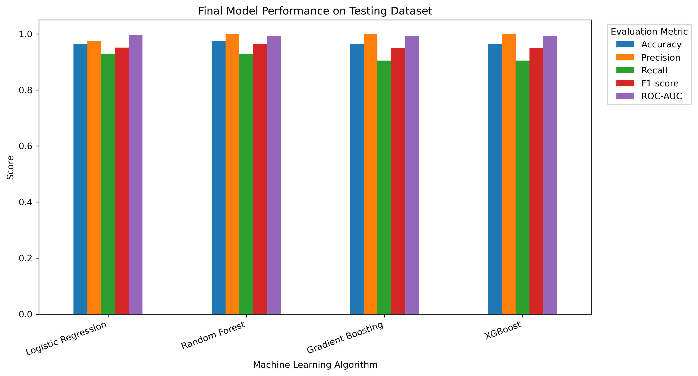
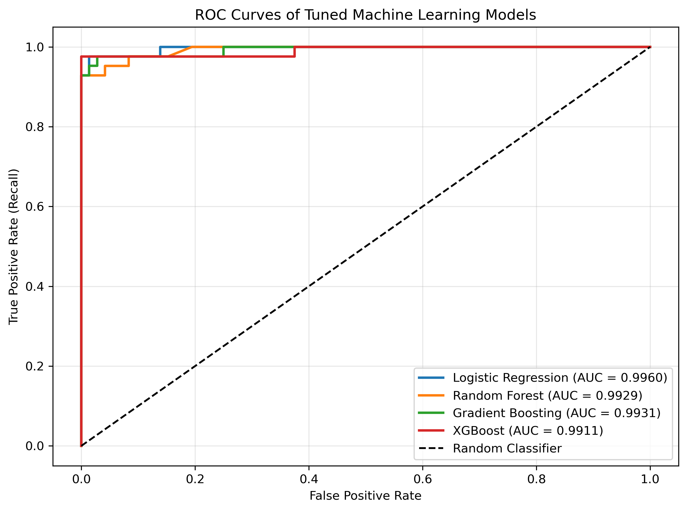
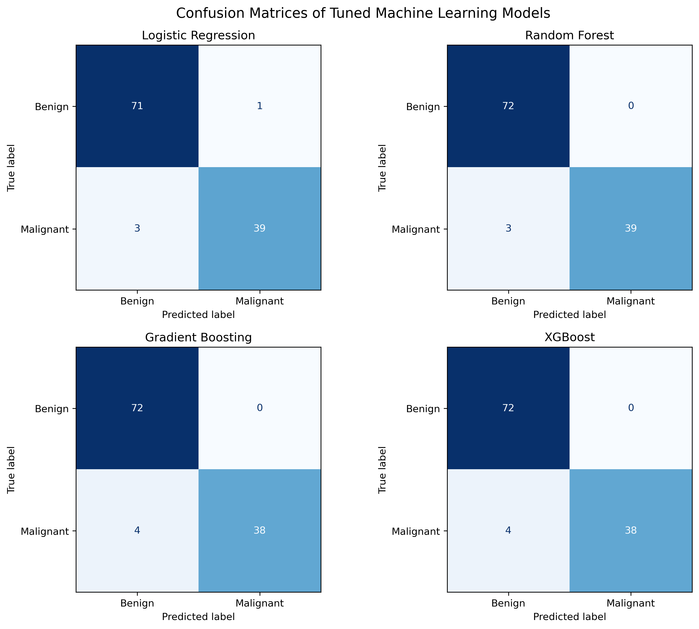
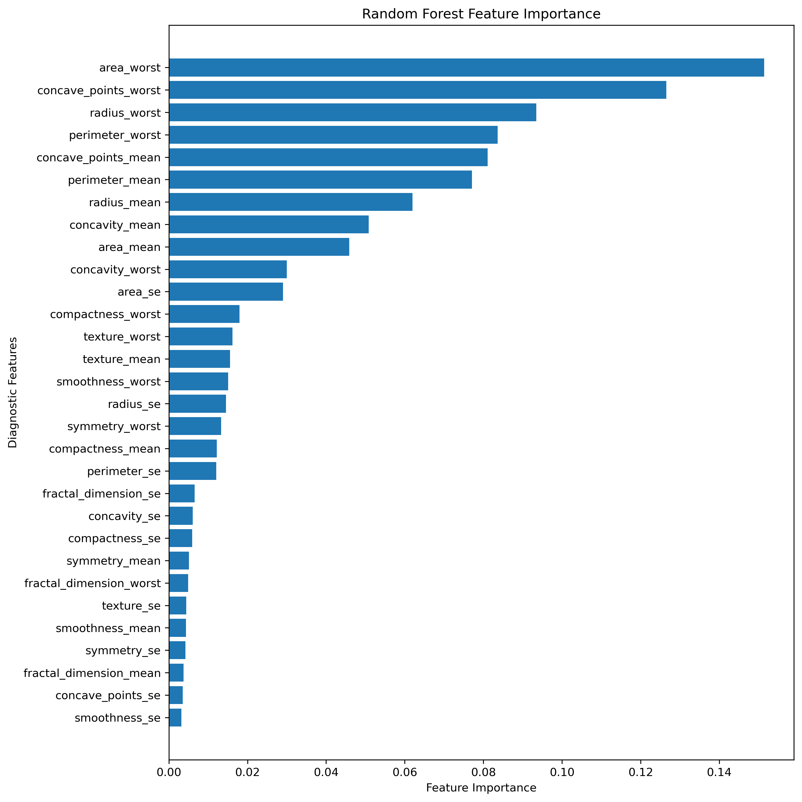

# Breast Cancer Diagnosis Prediction Using Machine Learning

**ECH6845 – Chemical Process Data Science**  
**University of Florida | Final Project**

## 1. Project Overview

This project investigates whether supervised machine learning models can distinguish **benign (B)** from **malignant (M)** breast tumors using numerical measurements of cell nuclei obtained from fine-needle aspirate images. Four classification algorithms are compared: **Logistic Regression, Random Forest, Gradient Boosting, and XGBoost**.

The goals are to compare predictive performance, evaluate errors in identifying malignant tumors, and investigate which diagnostic features contribute most to classification. This is an educational data science project, **not a clinically validated diagnostic tool**.

## 2. Dataset

**Source:** [Breast Cancer Wisconsin (Diagnostic), UCI Machine Learning Repository](https://archive.ics.uci.edu/dataset/17/breast+cancer+wisconsin+diagnostic)

| Dataset property | Value |
|---|---|
| Samples | 569 |
| Input features | 30 numerical measurements |
| Benign samples | 357 (62.74%) |
| Malignant samples | 212 (37.26%) |
| Missing values | None |
| Duplicate rows | None |
| Target encoding | Benign = 0; Malignant = 1 |

The features describe nuclear size, texture, and shape, with **mean**, **standard error**, and **worst** measurements. The sample ID is excluded from model training.

## 3. Data Exploration and Preprocessing

Exploratory data analysis included class distribution, boxplots, feature histograms, and a Pearson correlation heatmap. Malignant samples generally exhibited larger values for several size- and irregularity-related features. Strong correlations among radius, perimeter, and area measurements suggest overlapping predictive information.

The data were divided using a **stratified 80/20 train–test split** (`random_state=42`):

- **Training:** 455 samples (285 benign; 170 malignant)
- **Testing:** 114 samples (72 benign; 42 malignant)

All 30 diagnostic features were retained. Logistic Regression was fitted through a pipeline containing `StandardScaler` to avoid information leakage during cross-validation.

## 4. Model Development

The following models were evaluated:

1. Logistic Regression
2. Random Forest
3. Gradient Boosting
4. XGBoost

Initial performance was estimated using **5-fold stratified cross-validation** on the training data. **GridSearchCV** was then used to tune hyperparameters, selecting configurations by cross-validated **ROC-AUC**. The optimized models were evaluated once on the held-out test set.

Metrics: accuracy, precision, recall (sensitivity for malignant cases), F1-score, and ROC-AUC.

## 5. Results

### 5.1 Final Test-Set Performance

| Model | Accuracy | Precision | Recall | F1-score | ROC-AUC |
|---|---:|---:|---:|---:|---:|
| Logistic Regression | 0.9649 | 0.9750 | **0.9286** | 0.9512 | **0.9960** |
| **Random Forest** | **0.9737** | **1.0000** | **0.9286** | **0.9630** | 0.9929 |
| Gradient Boosting | 0.9649 | 1.0000 | 0.9048 | 0.9500 | 0.9931 |
| XGBoost | 0.9649 | 1.0000 | 0.9048 | 0.9500 | 0.9911 |

**Key observations:** Random Forest achieved the highest test accuracy (**97.37%**) and F1-score (**0.9630**). Logistic Regression achieved the highest ROC-AUC (**0.9960**). Both Logistic Regression and Random Forest correctly identified **39 of 42 malignant samples**, corresponding to **92.86% malignant recall**. The differences are small, and the limited test-set size prevents strong claims that one model is universally superior.

### 5.2 Model Comparison Figure



*Figure 1. Comparison of model performance metrics. The figure will display after `figures/model_comparison.png` is uploaded to this repository.*

### 5.3 ROC Curves



*Figure 2. Test-set ROC curves for the optimized models. All four models achieved ROC-AUC values above 0.99.*

### 5.4 Classification Errors

The confusion matrices below illustrate the classification performance of all four machine learning models on the test dataset.



**Random Forest** correctly classified all 72 benign samples and 39 of the 42 malignant samples, achieving the highest overall test accuracy (97.37%).

All four models produced false negatives, where malignant tumors were incorrectly classified as benign. Therefore, **malignant recall is particularly important** when evaluating model performance, alongside accuracy and other metrics.

### 5.5 Feature Importance

The Random Forest model identified the following as its four most influential predictors:

| Feature | Random Forest importance |
|---|---:|
| `area_worst` | 0.1514 |
| `concave_points_worst` | 0.1265 |
| `radius_worst` | 0.0935 |
| `perimeter_worst` | 0.0836 |

These findings suggest that nuclear size and shape irregularity are useful for classification. Because many features are correlated, individual impurity-based importance scores should not be interpreted as causal effects.



*Figure 3. Random Forest feature importance; upload the corresponding plot using this filename to display it here.*

## 6. Discussion and Limitations

All four algorithms performed well on this dataset, and the relatively simple Logistic Regression model remained competitive with more complex ensemble methods. Hyperparameter tuning provided modest improvements overall.

Important limitations include the **small dataset (569 samples)**, a **single held-out test split (114 samples)**, correlated predictors, and **3–4 missed malignant cases** per model. No independent external dataset was used to validate generalizability. These models are therefore intended for educational analysis rather than clinical decision-making.

Future work could explore repeated cross-validation, validation-based classification-threshold selection to reduce false negatives, permutation-based feature importance, and external validation.

## 7. Repository Contents

```text
ndehigampala97.github.io/
├── README.md
├── Breast_Cancer_Classification.ipynb
├── Breast_Cancer_Classification.html
└── figures/
    ├── model_comparison.png
    ├── roc_curves.png
    └── feature_importance.png
```

*This is the recommended structure; include only files that you have actually uploaded. If your notebook is inside a `notebooks/` folder, update the paths accordingly.*

**Full analysis:** [Jupyter notebook](Breast_Cancer_Classification.ipynb) | [Rendered HTML report](Breast_Cancer_Classification.html)

## 8. Reproducing the Analysis

1. Download the dataset file `wdbc.data` from the UCI source above.
2. Place the data file alongside `Breast_Cancer_Classification.ipynb`, or update the data path in the notebook.
3. Install the required Python packages: `numpy`, `pandas`, `matplotlib`, `seaborn`, `scikit-learn`, and `xgboost`, along with Jupyter.
4. Run all notebook cells in order to reproduce the analysis and figures.

```bash
python -m pip install numpy pandas matplotlib seaborn scikit-learn xgboost notebook
jupyter notebook Breast_Cancer_Classification.ipynb
```

## 9. References

- Wolberg, W. H., Street, W. N., and Mangasarian, O. L. **Breast Cancer Wisconsin (Diagnostic)**. UCI Machine Learning Repository. https://doi.org/10.24432/C5DW2B
- [scikit-learn documentation](https://scikit-learn.org/stable/)
- [XGBoost documentation](https://xgboost.readthedocs.io/)
